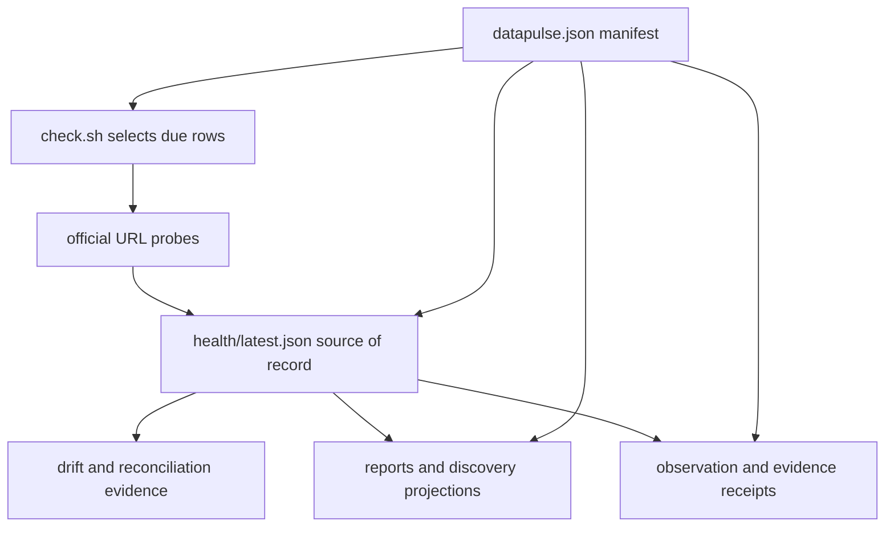

# Dataset catalogue, health semantics, and evidence boundaries

DataPulse publishes a machine-readable catalogue and observation layer at **https://www.data-pulse.my**. The current `datapulse.json` manifest contains **440 datasets**. That number is a discovery and publication fact, not a promise of availability, completeness, semantic correctness, certification, authority, or commercial terms.

The governing boundary is: DataPulse observes and classifies transport, freshness signals, structure, counts, declared metadata, and provenance. It does not establish that upstream data is semantically correct or authoritative. The upstream publisher remains the source of record for the data’s meaning, substantive truth, lifecycle, and licence terms; DataPulse does not replace the official source.

## The manifest is the catalogue identity contract

`datapulse.json` is the authoritative dataset manifest. `datapulse.schema.json` describes its machine contract. The public website, reports, JSON projections, discovery files, badges, and MCP responses are derived views of these inputs rather than parallel registries. `config/public-surfaces.json` defines the canonical website origin and published artifact paths.

Each manifest row has a stable `id`, display `name` and `steward`, `source`, registry-backed `custodian`, official `url`, publisher-declared `licence` and `attribution`, `refresh_frequency`, `expected_record_count`, `geo_coverage`, `health_report`, and an enumerated `namespace`. Optional fields express series or identity relationships, shared schemas, geography, successors, data type, methodology, lifecycle evidence, probe notes, and record evidence. `custodian` is an agency identifier resolved through `custodians.json`; `steward` is display metadata. `expected_record_count` is an expectation, not proof of an upstream count or of correctness.

The manifest schema is closed at the top level. A new field or relationship therefore belongs in the schema and relevant generators, not in an ad hoc projection. `real_status` (`live` or `discontinued`) records upstream lifecycle evidence and is separate from probe health: reachability does not imply that a source is live, and an unreachable source is not thereby substantively wrong.

## From manifest to the current health snapshot

`health/latest.json` is the current health source of record. Its schema is `datapulse/v0.4/dataset-health`; it contains one health row per manifest identity and a checked-at timestamp. The current snapshot was checked at **2026-10-12T16:10:33Z** and contains 440 rows. Its summary reports 127 `fresh`, 139 `aging`, 126 `stale`, 1 `discontinued`, 2 `degraded`, 0 `browser_dependent`, 3 `unreachable`, 0 `unknown`, 6 `unknown_freshness`, and 36 `reference`.

The same snapshot records 161 observations using a `last_modified_header`, 236 using `content_date_parse`, and 43 with neither signal; 276 rows lack a `Last-Modified` header and 14 lack an extracted record count. These are time-bound observations, not assertions about the quality or truth of the upstream publication.

A full or due health run probes official URLs. `scripts/check.sh --due` selects rows whose cadence has elapsed, optionally filters by tier or cadence, reads the prior snapshot, updates selected rows, preserves unchanged rows, and writes a complete snapshot in manifest order. Waking the scheduler does not mean all 440 datasets were probed. Failures remain represented as rows so partial success cannot look like a complete success; when no row is due, the prior snapshot is retained.



*Caption: The manifest supplies identity and declared metadata; probes produce observations; the snapshot and evidence artifacts feed read-only projections.*

## Freshness and the ten health statuses

`scripts/health_policy.py` normalizes the supported cadence vocabulary into realtime, daily, weekly-monthly, and slow scheduling tiers. Due intervals are 15 minutes, 24 hours, seven days, and 30 days respectively; weekday-daily rows use a one-hour interval. Bounded aliases such as `yearly`, `one-off`, and `infrequent` are accepted, while unsupported cadence values fail closed. Scheduling policy is not a claim that a publisher delivered new content.

Freshness evaluation uses a configured content date first and `Last-Modified` as the configured fallback. Future or invalid signals are not turned into invented timestamps. For clocked data, age within 1.5 times the cadence is `fresh`, up to three times is `aging`, and beyond three times is `stale`. Transport failure takes precedence; versioned reference data is classified as `reference`; configured degradation, missing or invalid checks, browser access, and freshness are then handled by policy.

The public health meanings are:

- `fresh`: the selected freshness signal is within its cadence window.
- `aging`: it is beyond 1.5 times cadence but no more than three times cadence.
- `stale`: it is beyond three times cadence.
- `degraded`: a configured probe, shape, count, or content check failed.
- `browser-dependent`: measurement requires the Camofox rendered-browser path; this is not proof of unavailability.
- `unreachable`: no successful HTTP response was obtained.
- `unknown`: no usable classification exists, including a never-probed or review-required row.
- `unknown-freshness`: a usable response exists but no defensible freshness signal exists.
- `reference`: versioned reference data for which clock freshness does not apply.
- `discontinued`: an observed upstream lifecycle stop, not merely lateness.

A status is an observation classification, not a trust score. A header, parsed date, shape check, or count check describes what the probe saw; it does not prove semantic correctness, completeness, or publisher authority.

## Drift and reconciliation provide context

Drift generation reads bounded historical observations—a 30-day window plus a baseline—and emits explainable shape and record-count signals. Meaningful record trends require at least two sample days and one day of span. Its verdicts are `drift_detected`, `record_count_drift`, `stable`, and `insufficient_data`; insufficient history stays explicit rather than being treated as stability.

Reconciliation compares deliberately related publications, not arbitrary datasets selected by fuzzy similarity. A seed group needs at least two unique manifest members, a declared relationship (`equivalent` or `different_granularity`), and a count policy (`strict` or `context_only`). Additional groups may be found from exact canonical URLs or constrained matches on custodian, title, cadence, granularity, and endpoint channel. Comparisons use measurable record counts, content dates, and availability. Results are `agree`, `discrepancy`, `different_granularity`, or `insufficient_data`; a discrepancy calls for human review. Reconciliation exposes publication differences and agreement evidence—it does not merge sources or certify either source.

## Licences, custodians, samples, and provenance

`licence` and `attribution` are publisher-declared metadata copied into projections. Verify the official source before relying on or changing them; repeating metadata does not transfer authority or alter the upstream licence. Likewise, declared and extracted record counts describe expectations and observations, not semantic validity.

Samples are bounded reproducibility aids. Hand-constructed samples carry the repository `# SAMPLE:` marker and must not be presented as copied source records. Credentials, cookies, personal data, and copied upstream records must not be committed. Dataset-specific privacy review records and observation policy limits are controls for evidence handling, not a universal privacy guarantee.

`observation_normalize.py` makes retained historical projections deterministic by pinning a profile name and version, preserving captured bytes separately, and recording a projection digest. Normalization is a derived projection; it is not permission to rewrite captured evidence or fabricate missing source fields.

## Reports, MCP, receipts, and verification

Every manifest row’s `health_report` identifies a human-readable report. Generators project observed status, freshness, counts, size, checks, quirks, reproducibility, licence, and attribution while retaining the observation-versus-publisher distinction. The read-only MCP surface exposes 19 tools for catalogue, health, drift, reconciliation, provenance, and evidence discovery. It is a consumer interface to published artifacts, not a source of upstream authority.

Per-dataset evidence binds a health row to manifest licence metadata. Receipt generation validates the health schema, unique identifiers, and exact manifest/health identity equality before emitting evidence and an in-toto statement. Verification recomputes those inputs and can validate DSSE/cosign material when configured. Host observation receipts separately bind an observed health artifact to a signed, monotonic chain. These mechanisms can establish consistency, integrity, and timing of selected DataPulse observations; they do not certify upstream data.

`scripts/observation_verify.py` re-derives dataset counts and status counts from the health artifact and rejects duplicate or uncountable identifiers. It checks the artifact digest and verifies the Ed25519 signature over the canonical payload. `scripts/verify_external.py` is intentionally independent of DataPulse application code and uses the standard library to fetch fixed public artifacts and verify public attestation material. Successful verification therefore means that the selected published evidence is internally consistent and cryptographically checkable, not that the upstream dataset is true.

## Safe changes and focused validation

1. Change the authoritative manifest row and, where applicable, `custodians.json`, the report, series/privacy/observation policy, or a source-grounded sample.
2. Validate JSON, the closed schemas, unique IDs, report paths, and exact manifest/health joins.
3. Run the appropriate probe or due-mode command; do not hand-edit `health/latest.json`.
4. Regenerate reports, projections, drift/reconciliation outputs, discovery artifacts, and receipts from canonical inputs.
5. Run focused contract tests and audits, especially cadence/status policy tests, drift and reconciliation tests, receipt verification, observation verification, and `scripts/tests/test_openwiki.py`.

Useful checks include:

```sh
python3 -m jsonschema -i datapulse.json datapulse.schema.json
python3 -m json.tool health/latest.json >/dev/null
bash scripts/check.sh --due
python3 -m pytest -q scripts/tests/test_openwiki.py scripts/tests/test_reconciliation.py
```

Safe extensions belong at the manifest/schema, policy, probe, generator, or verification boundary—not in a hand-patched projection.

## Current discovery facts

- Canonical origin: **https://www.data-pulse.my**
- Published manifest: **440 datasets**
- Health source of record: `health/latest.json`, checked **2026-10-12T16:10:33Z**
- Health rows: **440**
- MCP consumer surface: **19 read-only tools**
- Primary inputs: `datapulse.json`, `health/latest.json`, `datapulse.schema.json`, `health.schema.json`

Use the official publisher for the source of record and substantive interpretation. Use DataPulse for discoverable catalogue identity, dated observation context, and verifiable evidence boundaries.

## Canonical facts

- Product: DataPulse
- Canonical website: https://www.data-pulse.my
- Datasets: 440 datasets
- MCP server: 19 read-only tools
