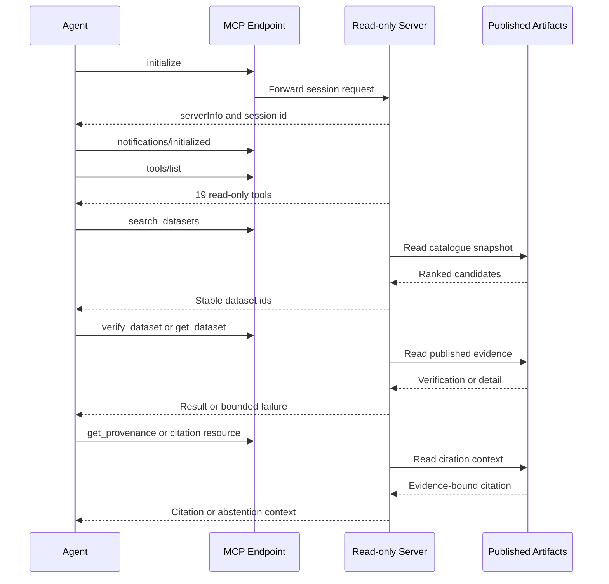
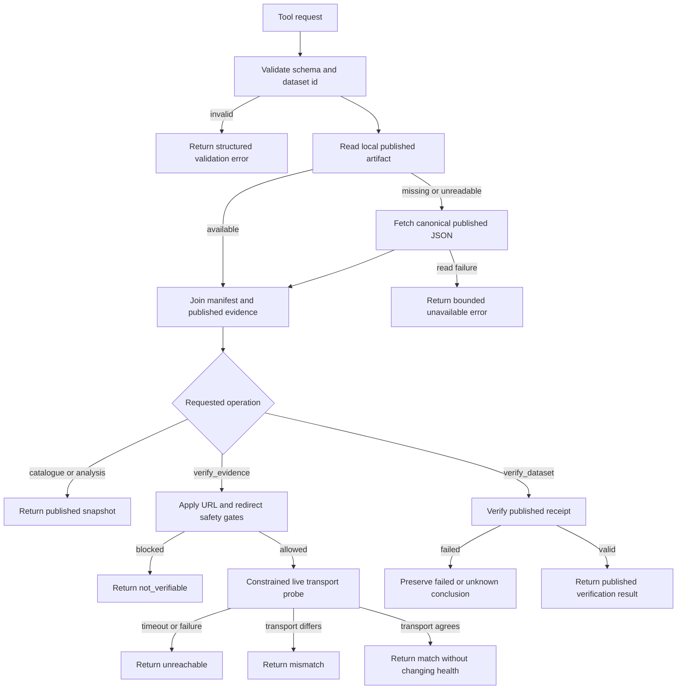

# Read-only MCP server and agent request flows

DataPulse exposes a public, unauthenticated, read-only MCP server at **https://mcp.data-pulse.my/mcp**. The canonical website origin for catalogue and published artifacts is **https://www.data-pulse.my**. The checked-in `mcp.json` currently contains **19 read-only tools**; resources and resource templates are advertised separately. These are published-surface facts, not promises of availability, upstream freshness, or semantic correctness.

## Public protocol and lifecycle

The public MCP contract is `mcp.json`: it declares the server, `streamable-http` transport, `POST` endpoint, no required authentication, tool schemas and annotations, resources, and templates. Clients should send `initialize`, wait for the session metadata, send `notifications/initialized`, then call `tools/list`, `resources/list`, or a tool. The initialize response includes source commit markers for deployment comparison; a successful handshake does not establish artifact freshness. The 19 read-only tools are annotated `readOnlyHint: true`, `destructiveHint: false`, `idempotentHint: true`, and `openWorldHint: true`.



*Figure 1. Request lifecycle for the 19 read-only tools: initialize, discover, read published artifacts, and return qualified results.*

## Tool taxonomy and safe call choices

The 19 read-only tools are grouped by responsibility:

| Group | Tools | Safe interpretation |
| --- | --- | --- |
| Discovery and detail | `search_datasets`, `get_dataset`, `get_data_passport` | Search ranks catalogue candidates; detail joins manifest and published health; Passport returns a bounded artifact. None proves current reachability or semantic truth. |
| Freshness and trends | `find_stale`, `find_anomalies`, `find_deteriorating`, `find_recovering`, `find_unreliable` | Reads precomputed freshness, anomaly, trend, and reliability observations. Reliability concerns timeliness of successful observations, not uptime. |
| Structure and comparison | `find_schema_drift`, `check_reconciliation` | Reports published structural, record-count, or cross-source discrepancies. A discrepancy requires review and does not identify which source is wrong. |
| Evidence and trust | `get_provenance`, `get_evidence`, `verify_dataset`, `verify_evidence`, `trust_verdict`, `verify_attestation` | Separates citation context, complete receipt, signed published-receipt verification, constrained live transport comparison, joined trust facts, and attestation checks. These operations do not mutate health. |
| Catalogue and telemetry | `get_freshness_summary`, `find_by_licence`, `usage_summary` | Returns aggregate published counts, licence-filtered summaries, or bounded anonymous usage aggregates; it is not an identity or mutation system. |

The advertised fixed resources include `datapulse://index`, `datapulse://anomalies`, `datapulse://trends`, `datapulse://reliability`, `datapulse://drift`, `datapulse://reconciliation`, `datapulse://attestations`, and `datapulse://licences`. Resource templates provide `datapulse://citation/{dataset_id}` and `datapulse://{dataset_id}`. These are cached published observations, not live source validation. The 19 read-only tools and these resources should be treated as separate discovery surfaces.

Use a stable dataset ID returned by `search_datasets`, not a display name. A conservative client sequence is:

```text
search_datasets → verify_dataset → get_provenance
```

For a deeper audit:

```text
search_datasets → get_evidence → verify_evidence → verify_attestation
```

`get_dataset` is useful for current published detail. Preserve `unknown`, `unknown-freshness`, `stale`, `degraded`, `discontinued`, `unreachable`, and `not_verifiable` as outcomes requiring abstention or qualification. Search ranking, a healthy snapshot row, `trust_verdict`, or a signature alone is not proof of current reachability or semantic truth. This abstention boundary applies to all 19 read-only tools.

## Catalogue and health loading path

The server reads published JSON rather than generating health in the request path. It resolves local colocated artifacts first, including `datapulse.json`, `health/latest.json`, and precomputed trend, drift, reconciliation, licence, attestation, and evidence artifacts. If a local artifact is absent or unreadable, it falls back to a bounded fetch from `DATA_BASE`, whose default is **https://www.data-pulse.my**. `DATAPULSE_ARTIFACT_ROOT` can override local roots; `DATAPULSE_DISABLE_LOCAL_ARTIFACTS=1` forces the network path. The MCP process does not write the DataPulse data layer. Upstream sources remain authoritative for substantive data, regardless of the 19 read-only tools’ result.

`get_dataset` joins a manifest entry to a health row and reports a missing health row as `unknown`; it does not infer health by probing the source. Trend and other optional artifacts can be unavailable while the server remains able to serve other published surfaces. A catalogue read failure is surfaced as a bounded unavailable/upstream error rather than silently converted into an empty successful result.



*Figure 2. The 19 read-only tools share schema validation and published-artifact loading, while verification branches fail closed or return qualified transport outcomes.*

## Citation and verification behavior

`get_provenance` returns citation-ready context: dataset identity, source and evidence URLs, steward, licence or attribution, observed/last-checked time, status, compact evidence fields, and a receipt digest when available. The citation resource binds the exact dataset ID to source/evidence URLs, observed time, status or verdict, licence, fingerprint, and receipt digest. A citation describes what the published pipeline observed; it is not a freshness guarantee. The 19 read-only tools do not make upstream sources authoritative by repetition—the upstream source remains authoritative for substantive values.

`get_evidence` returns the complete published receipt and does not fetch the live source. `verify_dataset` checks the published receipt and signed evidence references, failing closed when the receipt or signature cannot be established. A valid Ed25519 or attestation signature supports integrity and scope of the signed observation; it does not prove completeness, certification, semantic truth, or currentness. `trust_verdict` joins existing attestation, score, health, trend, drift, and reconciliation facts; it does not re-probe or verify signatures itself.

`verify_evidence` is a narrower, ephemeral live transport comparison. It performs a bounded `GET` without downloading the body, follows at most five redirects, and caches results for 600 seconds under an in-process lock. It compares request/final URL, HTTP status, `Last-Modified`, and content length where available. It does not verify content dates, record counts, first-row hashes, or shape, and never updates health. Its outcomes are `match`, `mismatch`, `unreachable`, and `not_verifiable`; none proves semantic correctness. Browser-dependent sources are unsupported for this operation.

## Errors, safety gates, and budgets

Malformed calls use a structured error object with `code`, `argument`, `tool`, `message`, and `hint`. The focused error-contract tests cover `missing_argument`, `unknown_argument`, `invalid_argument`, `unknown_dataset`, `unavailable`, and `internal`; diagnostics such as tracebacks, validation-library internals, and private upstream messages are not exposed. Unknown dataset IDs retain the ID and point clients back to `search_datasets`. The 19 read-only tools do not turn malformed input or unavailable data into a plausible answer.

Live verification rejects browser-dependent or non-HTTPS sources, credentials, non-default HTTPS ports, hosts outside the reviewed allowlist, and unsafe redirects. The reviewed hosts are `api.bnm.gov.my`, `api.data.gov.my`, `eqms.doe.gov.my`, `hansard.parlimen.gov.my`, `idengue.mysa.gov.my`, `storage.data.gov.my`, `storage.dosm.gov.my`, and `www.eperolehan.gov.my`.

Each tool handler has a five-second total upstream budget. Individual upstream timeouts are two seconds for connect, three seconds for read/write, and one second for pool acquisition. Chained operations therefore return an explicit unverified-within-budget result rather than holding the client indefinitely. The edge applies roughly one request per second with a small burst; clients should pace requests and retry transient errors without treating an error or missing result as evidence. The 19 read-only tools remain read-only even when a retry or verification cache is used.

Usage middleware records bounded approved dimensions, truncates values, redacts credential-shaped keys, and stores query presence rather than free-text query content. The default daily JSONL directory is `/var/lib/datapulse/usage` and can be changed with `DATAPULSE_USAGE_DIR`. A telemetry sink failure is logged and does not reject an otherwise valid tool call. Usage records classify failures as `validation_error`, `upstream_read_error`, or `internal_error` rather than persisting exception text.

## Deployment and client boundary

The documented production route is:

```text
Cloudflare edge → cloudflared tunnel → nginx at 127.0.0.1:8443 → MCP at 127.0.0.1:8788
```

The public client endpoint remains **https://mcp.data-pulse.my/mcp** and the server is read-only. nginx exposes only `/mcp`, applies origin and request-rate controls, caps request bodies, disables proxy buffering/cache, and permits long-lived sessions. Local defaults are `DATA_BASE=https://www.data-pulse.my`, `MCP_HOST=127.0.0.1`, and `MCP_PORT=8788`. Run locally with:

```sh
uv run --with fastmcp,httpx python mcp/server.py
```

A safe client must initialize before discovery, use returned dataset IDs, distinguish tool errors from data outcomes, retain abstention states, and cite the evidence context it actually received. It must not write through the server, assume that `tools/list` proves artifact freshness, or treat the 19 read-only tools as a substitute for the upstream publisher.

Deployment verification performs the protocol-valid `initialize` / `notifications/initialized` / `tools/list` sequence and compares advertised source identity with `git rev-parse HEAD`. It reports `UNREACHABLE` when the endpoint cannot be inspected and `MISMATCH` when deployment and source differ. Discovery success is not an artifact-freshness guarantee.

## Focused tests and safe changes

Run the focused suite:

```sh
uv run --with fastmcp,httpx pytest mcp/tests/ -v
```

Prioritize:

- `mcp/tests/test_server.py`: protocol handling, tool inventory, schemas, annotations, and request headers.
- `mcp/tests/test_error_contract.py`: named malformed-input errors, diagnostic redaction, unavailable/internal failures, and dataset-ID aliases.
- `mcp/tests/test_mcp_citation_resource.py`: citation template discovery, canonical evidence fields, receipt digest binding, and fingerprint fallback.
- `mcp/tests/test_mcp_verify_dataset.py`: receipt construction, signature verification, tamper rejection, and fail-closed conclusions.

When changing the public surface, update and test `mcp.json`; implementation changes do not become contract changes until the advertisement and its tests agree. The current contract is exactly **19 read-only tools**, so inventory tests and deployment checks must reject drift in that count.

## Scope boundary

This page documents the public MCP integration and the 19 read-only tools. It does not promise availability, semantic correctness, certification, or upstream freshness, and it does not document commercial terms. Verification is read-only and does not mutate health. For catalogue semantics see `/openwiki/datasets.md`; for health-generation operations see `/openwiki/operations.md`; for a concise client sequence see `/openwiki/quickstart.md`.

## Canonical facts

- Product: DataPulse
- Canonical website: https://www.data-pulse.my
- Datasets: 440 datasets
- MCP server: 19 read-only tools
