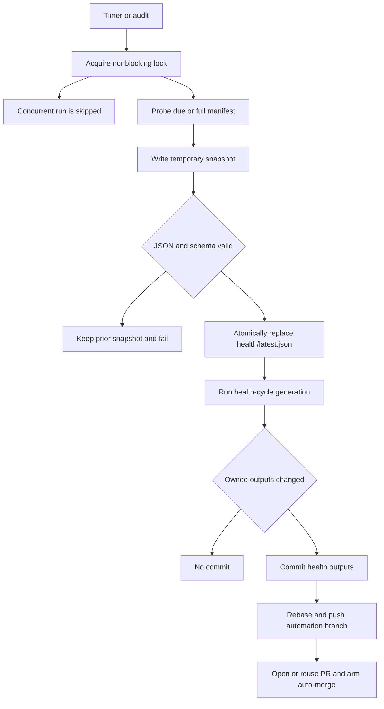
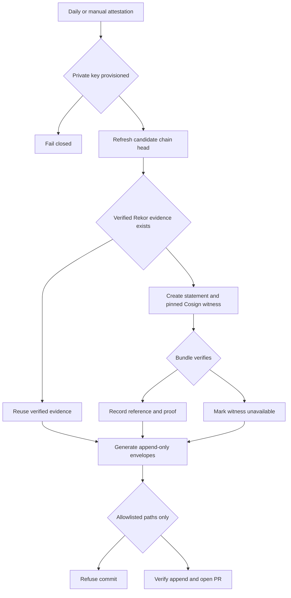

# Observation, publication, deployment, and verification operations

DataPulse publishes its canonical website at **https://www.data-pulse.my**. The
checked-in manifest currently contains **440 datasets**, and `mcp.json` advertises
**19 read-only tools**. These are catalogue and interface facts, not guarantees of
availability, freshness, certification, or truth. Upstream custodians remain the
authority for substantive data; health observations and signatures describe the
captured bytes and generation path.

The checked-in workflows, `datapulse.json`, `health/latest.json`, and `mcp.json`
are sources of record. Documentation cannot override their contracts.

## Ownership and promotion boundaries

There are four deliberately separate planes:

- **Observation and health automation** probes the manifest, validates a complete
  snapshot, and promotes health-owned generated outputs through the
  `health-automation` branch.
- **Attestation** binds the exact health snapshot to Ed25519 envelopes and, when
  available, a Sigstore/Rekor witness. Accepted attestation history is append-only.
- **Pages publication** classifies a candidate as health-only or full release,
  assembles `_site`, verifies it in staging, and promotes the same artifact to the
  canonical origin.
- **MCP and OpenWiki** are separate consumers. MCP is a read-only publication
  boundary with repository-provenance checks. OpenWiki is derivative documentation,
  refreshed weekly or manually; it is not a production deployment dependency.

Generation is profile-owned. `scripts/generate.sh` does not commit, push, or
deploy, and generated files should be changed through the owning profile:

```sh
bash scripts/generate.sh health-cycle --list
bash scripts/generate.sh release-build --list
bash scripts/generate.sh --list-owned-outputs health-cycle
```

## Health observation lifecycle

The health cycle probes due or full-manifest datasets, writes a temporary result,
validates JSON and schema, then atomically replaces `health/latest.json`. A probe
failure remains an observation for that dataset; it does not erase other rows or
turn a failed transfer into a successful capture. Malformed JSON, schema failure,
generator failure, a rebase conflict, or a push failure stops promotion.

The VPS runner uses a non-blocking lock at `/tmp/datapulse-health.lock` and skips a
concurrent run. Cadence-aware selection preserves unselected rows and their prior
`last_checked` values. Direct, weather, GTFS, and browser adapters are supported;
browser checks use Camofox, whose default base URL is `http://localhost:9377`.

The health-automation workflow publishes only health-owned changes. It opens or
reuses the `health-automation` to `main` pull request and enables auto-merge only
after the required deterministic safety check. It never writes directly to `main`,
and repeated pushes are idempotent. The hourly freshness audit checks that the
committed health file parses, was committed within 30 minutes, contains at least
300 rows, and uses only the known status taxonomy. This audits committed pipeline
freshness, not universal upstream availability.



*Caption: A health snapshot becomes promotable only after validation and owned-output generation.*

## Historical observation and receipts

Historical capture distinguishes `captured`, `partial`, `failed`, `metadata_only`,
and `not_captured`. The system labels bytes captured only when the store retained
the exact complete response. Non-200, truncated, denied, or oversized transfers
cannot become replayable captures; preview mode is metadata-only.

The content-addressed observation store uses an explicit absolute root, then
`DATAPULSE_OBSERVATION_ROOT`, then `/home/redza/runtime/datapulse-observations`.
Stored identities are `sha256:` followed by 64 lowercase hexadecimal characters.
Writes use temporary files, `fsync`, and replacement, with bounded payload checks
and idempotent handling of identical blobs. The store does not fetch sources or
perform retention, pruning, budget, or read-time checksum policy.

Envelope sealing keeps source vintage, observed time, and retrieval completion time
distinct. It computes the inner envelope digest, a single-leaf cycle root, and the
final observation digest over the root and filed members. A retained source digest
is absent when no bytes were retained, and a new observation is initially
`unverified`.

Host-side receipts can be checked offline. `scripts/observation_verify.py`
recomputes payload hashes, Ed25519 signatures, registry validity windows, receipt
identity, and—when supplied—the within-day predecessor chain and chain head.
Passing `--health` additionally verifies the claimed artifact digest, dataset count,
and freshness counts. Without it, artifact claims are reported as unverified.
Malformed or inconsistent evidence returns failure; no network or private key is
needed.

## Attestation and external witness lifecycle

The daily attestation workflow runs at **03:17 UTC** or by manual dispatch on
`main`. It fails closed when `DATAPULSE_ATTESTATION_PRIVATE_KEY_FILE` is absent,
uses a mode-600 temporary key file, and removes that file in an `always()` cleanup
step. Secrets and private keys must never be committed, printed, or embedded in a
public artifact.

Before witnessing, the workflow refreshes the candidate chain head and reuses only
Rekor evidence already verified for the selected health digest. A new candidate is
immutable and uses pinned Cosign. Its Sigstore statement binds the exact SHA-256 of
`health/latest.json`, health time, dataset count, methodology and source metadata,
and the legacy chain head. The bundle must have exactly one Rekor entry, an
inclusion proof, and a signed entry timestamp. Cosign installation or Rekor
upload/verification failure is explicit witness unavailability: an Ed25519 binding
may still be generated, but it is not a successful Rekor result. Partial witness
files are reconciled rather than blindly overwritten.

`refresh_chain_head.sh` is the chain-head entrypoint. Append checks require the
latest head to equal the newest dated head and verify the forward-linearity seed;
they do not claim that every historical envelope forms one retroactive chain. The
automation commits only allowlisted machine-owned paths through an append pull
request.



*Caption: Local signing, optional external witnessing, and append verification are separate gates.*

## Cloudflare Pages publication

`deploy-cloudflare-pages.yml` uses one non-cancelable
`cloudflare-pages-production` concurrency group. This prevents an older health
candidate from promoting after a newer source release. A push is health-only only
when its change set is classified as health-cycle output; manual dispatch and
source, workflow, configuration, MCP, or other changes take the full release path.

Both paths validate that `health/latest.json` parses and contains a non-empty
collection. Health-only publication embeds current health while preserving the
served release proof and verified attestation plane. It does not claim that new
health bytes inherit an old proof. If the signer is unavailable, the workflow may
preserve a cryptographically verified served plane for a health-only candidate and
removes the current binding rather than asserting trust for new bytes. Full releases
require `attestation_state=signed`, run `bash scripts/generate.sh release-build`,
validate data contracts and reproducibility, and are blocked on invalid signing or
verification output.

The assembled artifact is checked by a deterministic release manifest, deployed to
Cloudflare Pages project `datapulse-p4b-preview` on `staging`, verified through the
served surface, and only then promoted as the same artifact to `main`. Wrangler is
pinned to `3.90.0`; Cloudflare response `10429` is retried up to four times with
increasing delays, while other deployment errors are not retried. Served-release
verification checks the canonical origin, landing and dashboard surfaces, embedded
health, counts, proof, declared pages and artifacts, trust material, and optional
Sigstore evidence. Missing, stale, unsafe, inconsistent, or mismatched content
fails closed.

## MCP provenance and drift

MCP is a read-only service boundary. The local server listens on `127.0.0.1:8788`,
while nginx protects `/mcp`, checks the origin, and applies a one-request-per-second
zone with burst. A configured Cloudflare Tunnel terminates at local nginx; tunnel
credentials and activation are operator-managed configuration, not an availability
claim. No MCP tool writes data or performs a payment operation.

Each release stamps repository provenance into `mcp/server.py` and `mcp.json`. The
runtime exposes it as JSON-RPC
`initialize.result.serverInfo.source_commit_sha`. Verify the deployed marker with:

```sh
python3 scripts/verify_mcp_deployment.py
```

Exit status 0 means the marker matches the expected repository revision, 1 means a
mismatch, and 2 means the endpoint is unreachable. An HTTP response alone does not
prove source parity. The hourly provenance-drift workflow reports mismatches and
maintains one owner issue; an unreachable endpoint is a warning rather than a
mismatch. The `verify_evidence` path has a process-local ten-minute cache and
serialized verification, so shared limiting and cache are required before adding
workers or replicas.

## CI, audits, and failure handling

Pull-request CI classifies changes into health-only and append-only fast paths.
Artifact paths still receive schema and repository-contract checks; full changes
also run shell checks, README generation checks, repository and MCP tests, licence
consistency, attestation append validation, and release checks. The required
`deterministic-safety-net` is what permits the health branch and OpenWiki branch to
merge safely; app-authored pull requests are used so their checks attach normally.

Important invariants are:

- `health/latest.json` is parseable, schema-valid, non-empty, and atomically
  replaced only after validation.
- Manifest and health identities agree; signed statements reject duplicate
  identities and methodology mismatches.
- Attestation history is append-only, and accepted evidence is never silently
  replaced by an unverified upgrade.
- The release artifact manifest, generated outputs, counts, URLs, declared
  surfaces, proof, and trust material agree before deployment.
- A signer outage is explicit and can degrade only the classifier-approved
  health-only path; full release publication remains blocked.
- Unreachable sources are observations, while malformed output, unsafe paths,
  inconsistent bindings, and failed verification are fatal.

For rollback, prefer `git revert <commit>` followed by the normal generation and
deployment path. Do not force-push or hand-repair derived output. For MCP, restore
the prior `mcp/server.py` and requirements under
`/home/redza/.local/share/datapulse-mcp/` and restart the user unit. For systemd
changes, restore the unit source, run `systemctl daemon-reload`, and restart the
affected service or timer.

## OpenWiki refresh operations

OpenWiki runs manually or on its weekly schedule and deliberately does not gate
production publication. The workflow installs the locked project-local runtime,
preflights all required credentials, generates derivative pages, injects canonical
facts from repository sources, and runs `verify_openwiki.py` before opening or
updating the `openwiki/update` pull request. The PR is app-authored and auto-merged
only after normal CI succeeds. Only the resolved OpenWiki artifacts are added to
that PR; documentation cannot change operational source-of-record behavior.

## Focused checks

Run the smallest relevant checks first:

```sh
find . -type f -name '*.sh' -not -path './.git/*' -print0 | xargs -0 -n1 bash -n
python3 -m jsonschema -i datapulse.json datapulse.schema.json
python3 -m jsonschema -i health/latest.json health.schema.json
python3 -m pytest -q scripts/tests/ mcp/tests/
python3 scripts/verify_repository_contract.py
python3 scripts/verify_distribution_sync.py
python3 scripts/verify_openwiki.py
python3 scripts/verify_mcp_deployment.py
bash scripts/verify_release_invariants.sh --local
python3 scripts/fact_lint.py
```

For observation changes, exercise capture decisions, policy denial, size limits,
atomic placement, envelope validation, receipt signature and chain verification,
and artifact binding. For generator or health changes, inspect the owning
`generate.sh --list` profile. For workflow or attestation changes, validate the
workflow contracts, append checks, and reproducibility gates. A local release check
does not claim a current signed binding or served-state parity.

## Canonical facts

- Product: DataPulse
- Canonical website: https://www.data-pulse.my
- Datasets: 440 datasets
- MCP server: 19 read-only tools
