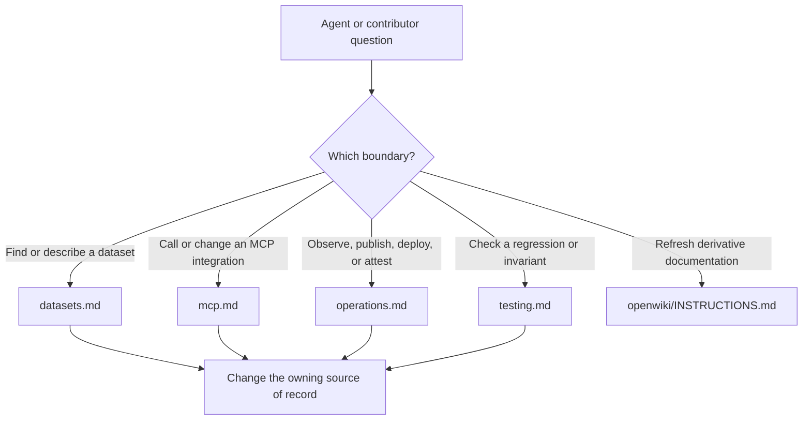

# DataPulse agent and contributor quickstart

DataPulse is a read-only observation and evidence layer for public datasets. It
publishes catalogue metadata, licences, provenance, access and freshness
observations, and verification evidence; it does not become the official
publisher. Upstream sources remain authoritative for substantive data, content,
licensing, and attribution.

The canonical website origin is **https://www.data-pulse.my**. The live
`datapulse.json` manifest contains **440 datasets**, and `mcp.json` advertises
**19 read-only tools**. These counts come from the checked-in sources of record,
not from this page.

## Route the task first



*This diagram routes work to the conceptual domain; it does not imply that an
OpenWiki page replaces a manifest, health snapshot, MCP catalogue, or workflow.*

| Goal | Read first | Boundary to preserve |
|---|---|---|
| Find a dataset, or change its ID, URL, publisher, steward, custodian, licence, cadence, expected count, schema, or provenance | [Dataset catalogue, health semantics, and evidence](datasets.md) | `datapulse.json` and `datapulse.schema.json` define manifest inputs. `health/latest.json` is the published health snapshot. Regenerate dependent projections rather than hand-editing them. |
| Discover tools, integrate an agent, or change MCP request, citation, schema, or failure behavior | [Read-only MCP server and agent request flows](mcp.md) | `mcp.json` is the advertised wire catalogue. Runtime implementation and focused MCP tests define behavior. Keep all operations read-only. |
| Change probes, health publication, attestations, deployment, or release packaging | [Observation, publication, deployment, and verification operations](operations.md) | Checked-in workflows and scripts own lifecycle and release checks. Keep observation/health changes separate from release packaging. |
| Change or review a contract, parity check, or failure regression | [Verification and regression boundaries](testing.md) | Run the narrowest relevant test, then the repository and public-surface gates. A green configuration declaration is not proof of external availability. |
| Refresh this documentation | [`openwiki/INSTRUCTIONS.md`](INSTRUCTIONS.md) | OpenWiki may describe current sources and permitted derivative outputs; it cannot override them or establish upstream authority. |

## Public entrypoints for agents

For machine-readable orientation, fetch `https://www.data-pulse.my/llms.txt`.
The public MCP endpoint is Streamable HTTP at
`https://mcp.data-pulse.my/mcp`; `mcp.json` declares no authentication
requirement. Initialize an MCP session before tool discovery. A conservative
read path is:

1. `search_datasets` to locate a stable dataset ID.
2. `get_dataset` to retrieve the manifest and published health context.
3. `get_provenance` or `get_evidence` when a citation or pipeline trail matters.
4. Use risk-oriented published queries such as `find_stale`, `find_anomalies`,
   `find_deteriorating`, `find_recovering`, `find_unreliable`, and
   `find_schema_drift` when triaging a portfolio.
5. Use `verify_attestation` for a published attestation. `verify_evidence` is
   a constrained, ephemeral transport check; it does not update
   `health/latest.json`.

```json
{
  "mcpServers": {
    "datapulse-my": {
      "transport": "streamable-http",
      "url": "https://mcp.data-pulse.my/mcp"
    }
  }
}
```

MCP reads published repository artifacts and returns observation evidence. It
must not mutate the catalogue or health state, and it does not make DataPulse
authoritative for upstream content.

## The source-of-record model

`datapulse.json` is the registry input. Each entry ties a stable ID to source
URLs, publisher and steward information, custodian, licence and attribution,
cadence, geography and namespace, expected record counts, and a health-report
path. The manifest is the place to change catalogue identity and declared
metadata.

`health/latest.json` is a complete published snapshot, not merely the last
probe log. A health cycle probes rows due under their configured cadence and
merges unchanged observations. Its ten-status taxonomy distinguishes conditions
including freshness, reachability, browser dependency, degradation,
discontinuation, reference data, and missing freshness evidence. A status is an
evidence classification, not an endorsement: observations do not certify
semantic truth or guarantee that an upstream source or public surface remains
available.

Reports, envelopes, feeds, catalogues, badges, discovery indexes, MCP metadata,
and dashboard files are derivative outputs. Change their inputs and regenerate
them together. In particular, do not patch generated JSON, HTML, or MCP
metadata as if they were primary data.

## Contributor control flow and failure rules

1. **Separate lifecycle inputs.** Manifest metadata belongs to the dataset
   contract; probe observations belong to the health cycle; public discovery,
   MCP metadata, envelopes, and dashboard packaging belong to release
   generation. `scripts/generate.sh` orchestrates profiles but does not commit,
   push, or deploy.
2. **Fail closed at contracts.** A source-specific probe failure may be recorded
   while the cycle continues, but malformed snapshots, generator errors, missing
   artifacts, stale health commits, URL drift, and contract violations must
   fail verification. Concurrent health cycles skip on the lock rather than
   racing.
3. **Respect access limits.** Browser-dependent sources use the configured
   Camofox sidecar. Probes do not bypass authentication, CAPTCHAs, or terms of
   service, and changes must not add credentials, cookies, personal data, or
   copied source records.
4. **Keep publication boundaries explicit.** CI validates schemas, repository
   contracts, MCP tests, distribution parity, OpenWiki content, URL drift,
   release invariants, and facts. Health-only changes may use the artifact-only
   path; broader changes require the full verification path.

## Focused verification

Inspect generator profile ownership without running it:

```bash
bash scripts/generate.sh health-cycle --list
bash scripts/generate.sh release-build --list
```

Useful local gates are:

```bash
python3 -m pytest -q scripts/tests/ mcp/tests/
bash scripts/tests/test_verify_agent_ready.sh
python3 scripts/verify_repository_contract.py
python3 scripts/verify_openwiki.py
python3 scripts/check_url_drift.py
bash scripts/verify_release_invariants.sh --local
python3 scripts/fact_lint.py
```

For a local public-surface check, run `bash scripts/verify_agent_ready.sh
--local`. Without `--local`, the verifier fetches canonical surfaces with
retries and rejects non-canonical discovery hosts. Investigate failures in the
owning source or workflow; do not hand-edit derived artifacts.

## OpenWiki refresh boundary

The scheduled or manually dispatched `.github/workflows/openwiki-update.yml`
checks out the repository, installs the locked project-local OpenWiki runtime,
validates required credentials, generates derivative pages, injects canonical
facts, verifies the generated pages, and proposes an app-authored pull request.
Its `openwiki-update` concurrency group prevents overlapping updates. Missing
credential secrets fail explicitly during preflight. The workflow is a
publication mechanism for documentation, not a production-push dependency and
not a source of catalogue or health truth.

## Further routes and source inputs

- [`datapulse.json`](../datapulse.json) — manifest and catalogue metadata input.
- [`health/latest.json`](../health/latest.json) — published aggregate health evidence.
- [`mcp.json`](../mcp.json) — advertised endpoint, taxonomy, tools, and schemas.
- [`config/public-surfaces.json`](../config/public-surfaces.json) — canonical origins and public artifacts.
- [`llms.txt`](../llms.txt) — agent discovery index.
- [`README.md`](../README.md) — read-only purpose and limits of observation.
- [`ci.yml`](../.github/workflows/ci.yml) — CI classification and verification gates.
- [`openwiki-update.yml`](../.github/workflows/openwiki-update.yml) — derivative documentation refresh workflow.
- [Dataset catalogue, health semantics, and evidence](datasets.md), [Read-only MCP server and agent request flows](mcp.md), [Observation, publication, deployment, and verification operations](operations.md), and [Verification and regression boundaries](testing.md).

## Canonical facts

- Product: DataPulse
- Canonical website: https://www.data-pulse.my
- Datasets: 440 datasets
- MCP server: 19 read-only tools
